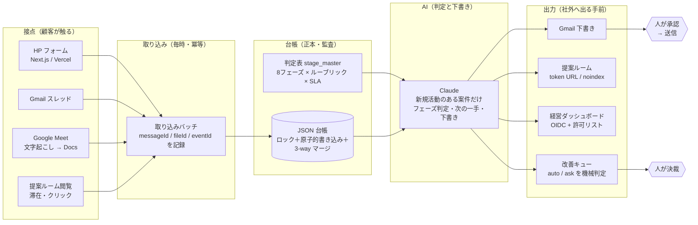

# AI活用・業務改善ポートフォリオ ｜ 佐々木 優希

営業・マーケティングの業務を「現場が入力しなくても回る」形に設計し直し、Claude Code を主開発環境に **要件定義 → プロトタイプ → 実装 → 検証 → 運用改善** まで自分で回してきた記録です。
所属は株式会社キャスター（東証グロース上場・BPO）。営業・マーケティング本部の統括と AI 責任者を兼務しています。

> 営業組織の生産性を上げるのが仕事です。手段は時代ごとに「人」→「仕組み（SFA）」→「働き方」→「AI」と変わり、AI で初めて「人が入力する前提」を外せました。
> その結果がチーム受注率 **8% → 45%**、営業・マーケ組織 **25名 → 15名**、営業を介さない受注 **月10件** です。

- 自己紹介ページ: https://jikoshoukai-five.vercel.app
- ポートフォリオサイト（本リポジトリの読みやすい版）: 公開後に追記
- 公開デモ: [未来の営業組織](https://mirai-eigyo-soshiki.vercel.app) ／ [学習ダッシュボード](https://learning-dashboard-demo-black.vercel.app) ／ [AI道場（研修サイト）](https://ai-dojo-demo.vercel.app) ／ [導入事例インタビュー（コレタ）](https://www.coleta.jp/case/cst)

---

## 1. 何をどう作ってきたか（一覧）

数字はすべて自分で測った実測値です。複数施策を同時に進めた期間の前後比較で、AI ツール単体の寄与を切り出したものではありません。

| # | プロジェクト | 課題 | 作ったもの | 検証結果 | 詳細 |
|---|---|---|---|---|---|
| 01 | 商談前リサーチ・提案生成パイプライン | 商談準備に営業が毎回30分。品質が人に依存 | カレンダー検知 → 企業情報収集 → 競合/NG判定 → 仮説レポート・提案スライド・ナレーション動画・顧客専用ページを生成 → Slack通知 | 準備 30分→3分、提案資料 1時間→5分 | [docs/01](docs/01_deal_prep_pipeline.md) |
| 02 | 商談後の自動処理（録画→CRM） | 営業が CRM に入力しない。溜まるのは後から書いた二次情報 | 商談録画 → 要約 → CRM 自動入力 → 説明漏れ項目を Slack 通知 → 類似事例レコメンド | 入力 20分→1分。入力ゼロで案件情報が揃う | [docs/02](docs/02_post_meeting_crm.md) |
| 03 | 社内ナレッジBot・AIコンシェルジュ | 「担当者に聞かないと分からない」が営業・CS の時間を奪う | Slack・Notion を取り込む RAG Bot（FastAPI／Firestore／Cloud Run）。同じ基盤で Web・LINE・Slack から申し込み完結のサービス案内AI | HP の AI チャット＋FAQ動画約30本で、営業を介さない受注 月10件 | [docs/03](docs/03_knowledge_bot.md) |
| 04 | 顧客専用ページ（提案ルーム）と上申支援 | 担当者は納得しても、決裁者を説得できず失注 | 推測不能トークン URL・noindex・閲覧ゲート付きの顧客専用ページ。上申用の動画と資料、閲覧イベントの記録 | 決裁者閲覧を検知して次の一手へ。受注率 8%→45% の土台 | [docs/04](docs/04_proposal_room.md) |
| 05 | 案件管理OS（入力ゼロで動く自作 SFA） | SFA を入れても現場は入力しない（前職で売る側として痛感） | Gmail／Meet 文字起こし／閲覧イベントを毎時取り込み → ルールで案件に紐付け → AI がフェーズ判定・次の一手・メール下書き → 人が承認して送信 | フォーム送信から一次返信・提案ページ生成まで 7分。人が触るのは承認の1回 | [docs/05](docs/05_deal_os.md) |
| 06 | 無人で回す AI エージェント基盤 | 営業・マーケの定型業務を人がいなくても回したい（新規事業のプロトタイプ） | launchd から Claude Code をヘッドレス実行する定時ルーティン 38本。失敗検知・watchdog・改善キューへの自動起票・メール通知 | SNS 投稿・記事公開・フォーム営業下書き・週次 PDCA まで無人化 | [docs/06](docs/06_agent_platform.md) |
| 07 | 自己改善ループ（改善キューと PDCA 三層） | AI が「迷ったら提案」で止まり、改善が1週間止まる | 種別で「自動実行／人の判断」を機械判定するポリシー。変更前スナップショット・判定ライン・木曜判定・2回失敗で格上げ | 週次 PDCA が出した改善の大半を人の手を待たずに適用 | [docs/07](docs/07_kaizen_loop.md) |
| 08 | 顧客向け Web アプリと経営ダッシュボード | 決済 → 環境発行 → 納品を人手でやると回らない | Next.js／Vercel／PostgreSQL（Neon）／Stripe。API 42本。決済完了 → 1社1環境を自動発行 → 納品メール。施策・KPI・ルーティン稼働を1画面に集約 | 決済から納品まで無人。責任者の承認はダッシュボードのボタン1つ | [docs/08](docs/08_webapp_dashboard.md) |
| 09 | 全社 AI 棚卸と研修（定着まで） | 「AI を使え」と言うだけでは現場は変わらない | 部門横断で業務を棚卸し → 自動化レベル・削減工数・難易度を付与 → Go/NoGo。レベル別プロンプト集と学習ダッシュボードで定着を測る | 3社で実装・定着。研修サイトと学習ダッシュボードは公開デモあり | [docs/09](docs/09_ai_inventory_training.md) |

Claude Code の使い方そのもの（CLAUDE.md・スキル・フック・チェックポイント運用）は [docs/00_how_i_build_with_claude_code.md](docs/00_how_i_build_with_claude_code.md) にまとめました。

---

## 2. 全体像（人が触るのは4カ所）



人が触る4カ所＝①下書きを承認して送信 ②商談に出る ③受注・失注の確定 ④施策の決裁。送る・公開する・払う・消すは必ずここを通ります。

---

## 3. 技術スタックと「壊れない設計」

| 領域 | 使っているもの |
|---|---|
| 開発環境 | Claude Code（主）。スキル 44本・フック・MCP 連携を自作して開発環境自体を拡張。Cursor 併用 |
| 言語・FW | Python（ルーティン・バッチ 61本・約2.2万行）、TypeScript／Next.js（約5.7万行）、Google Apps Script、FastAPI |
| 基盤 | Vercel、GCP Cloud Run／Cloud Build（Docker）、Firestore、PostgreSQL（Neon）、launchd による定時実行、Git（約2,700コミット） |
| AI | Claude（ヘッドレス `claude -p`／API）、Gemini API、RAG 構成、ElevenLabs（ナレーション） |
| 連携 | HubSpot・Zoho・Mazrica（SFA/CRM）、Slack、Notion、LINE、Stripe、Gmail、GA4／Search Console、Webhook |

**壊れない設計の作法**（コードは `samples/` に匿名化して置いています）

- 台帳 JSON はロック付きの原子的書き込み＋3-way マージ。複数ルーティンが同時に書いても更新が消えない → [`samples/ledger_io.py`](samples/ledger_io.py)
- 二重実行・二重送信ガード（messageId で冪等、同一宛先への20時間以内の連投を拒否）
- 失敗は自動で改善キューに起票して即時メール、未発火は watchdog が検知
- cron 式を launchd に変換して登録する際、実行中のジョブを道連れに殺さない → [`samples/cron_to_launchd.py`](samples/cron_to_launchd.py)
- 「自動実行」と「人が判断」を種別で機械判定するポリシー → [`samples/kaizen_policy.py`](samples/kaizen_policy.py)
- チェックポイントからの再開（ネット断で完了済みをやり直さない）
- 社外に出る文面は「説明どまり」「禁止表現」を機械で監査 → [`samples/copy_guard.py`](samples/copy_guard.py)
- Claude Code 自体にガードレール（危険なツール呼び出しを PreToolUse で止める／セッション終了時に自動コミット） → [`samples/hooks/`](samples/hooks/)

---

## 4. 進め方（顧客の業務を理解する → 何を作るか決める → 運用改善まで）

1. **業務を聞き切る** 「営業を2人採用したい」の裏にある「受注率を上げる仕組みがない」まで。数字は リード数・商談数・受注率のどこを動かすかを先に決める
2. **人が入力しないフローを先に描く** 入口（既存の接点）→ 取り込み → 台帳 → AI → 出力の順で、どこで人が承認するかを決めてから作る
3. **プロトタイプを数日で出して現場に当てる** 最初の仮説は大抵外れる。外した理由を残す（失敗した施策も記録する）
4. **本番は「壊れない設計」で** 冪等・ロック・ガード・通知・ロールバック。測れない変更は残さない
5. **運用改善を仕組みにする** 週次 PDCA → 改善キュー → 自動適用 → 翌週判定。人の判断が要るものだけ上げる
6. **定着まで見届ける** 研修・レベル別プロンプト集・学習ダッシュボードで「使われているか」を測る

---

## 5. このリポジトリの中身

```
README.md                      ← この文書
docs/00_how_i_build_with_claude_code.md   Claude Code の使い方（CLAUDE.md・スキル・フック・チェックポイント）
docs/01〜09_*.md                各プロジェクトの 課題 → 設計 → 実装 → 検証 → 運用改善
samples/
  ledger_io.py                 台帳 JSON のロック＋原子的書き込み＋3-way マージ
  cron_to_launchd.py           cron 式 → launchd plist 変換・安全な再登録
  kaizen_policy.py             改善キューの auto/ask 機械判定（抜粋）
  copy_guard.py                LP・記事コピーの「説明どまり」「禁止表現」監査
  hooks/browser_guard.py       Claude Code PreToolUse フック：危険なツール呼び出しを止める
  hooks/git_autocommit.py      Claude Code Stop フック：触ったファイルだけ自動コミット＋push
  claude-code/                 CLAUDE.md・SKILL.md・settings.json のフック設定の例
```

本番コードは顧客情報・認証情報を含むため非公開リポジトリで運用しています。ここに置いたサンプルは、固有名・パスを汎用化したうえで、そのまま動く形にしてあります。

---

## 6. 経歴（要約）

| 期間 | 会社 | 役割 | ひとことで |
|---|---|---|---|
| 2024.01〜 | 株式会社キャスター（BPO・東証グロース） | 営業・マーケ本部統括 → AI 責任者 | 受注率 8%→45%・新規獲得 MRR 月610万→1,270万円・25名→15名。AI 実装は自ら |
| 2021.12〜2024.01 | 株式会社マツリカ（SFA/CRM） | エンタープライズ営業マネージャー | 達成率 120%・大手で複数年の大型受注。「SFA を入れても現場は入力しない」を見た |
| 2018.12〜2021.12 | ミイダス株式会社（人材 SaaS） | 法人営業 → 営業マネージャー | 入社3ヶ月でトップ・MVP。営業組織 20名→200名・MRR 約2,000万→約2.5億円 |
| 2014.04〜2018.12 | 近畿日本ツーリスト × KADOKAWA 合弁 | 営業 → 営業統括 | 観光コンサル。年商2億円・新人賞 |

3社連続で入社3ヶ月以内にトップセールス。非エンジニアですが、要件定義 → コード → デプロイ → 運用・監視まで自分で行い、本番化・大規模化はエンジニアと分担する前提で動きます。
